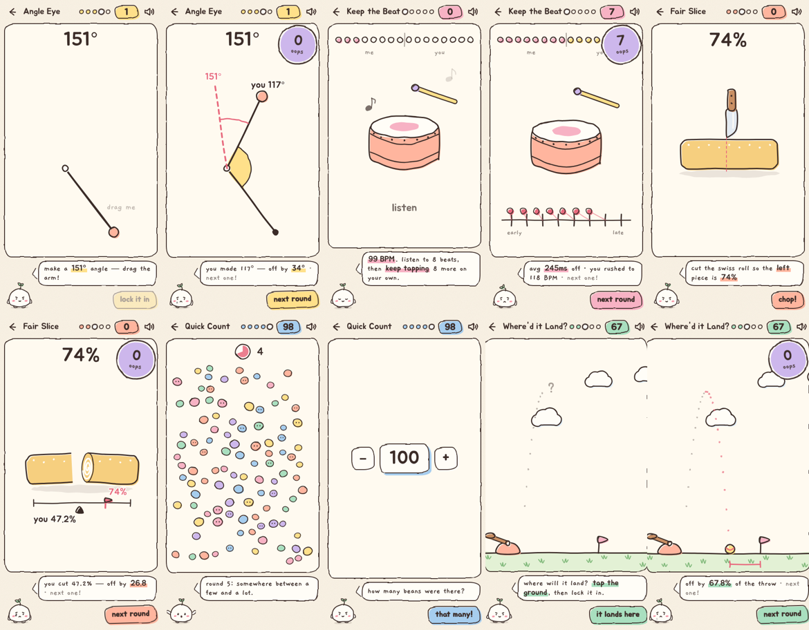
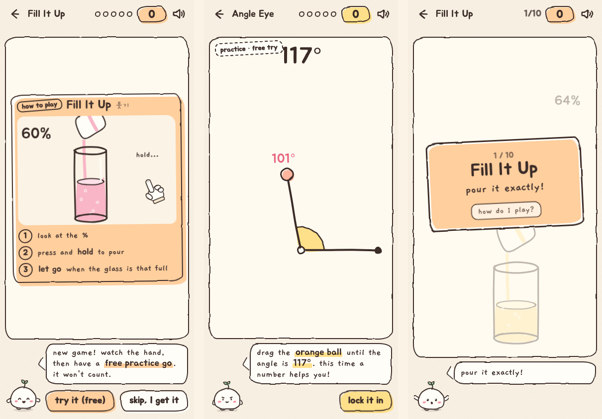

# 대충 · daechung

*adv.* roughly, more or less, by eye.

**Play: https://goshuajoh.github.io/daechung/**

Ten tiny hand-drawn mini-games that test how good your eyeball is, hosted by **Kongi (콩이)**, a little bean-sprout mochi.




## Ways to play

- **Daily 대충**: all 10 mini-games back to back, each on a countdown. The puzzles come from today's date, so everyone gets the same run.
- **Quick Run**: same format, random every time.
- **Party**: pass the phone. 2–8 players get the identical run (5 or 10 games), then there's a podium and a "closest eyeball per game" list.
- **Practice**: any single game, 5 rounds that get harder, no clock.

In runs, each game scores up to **100 for accuracy + 20 speed bonus** (how much of the countdown was left).

### First time? It teaches you

The first time you meet a game (per device, or per player name in Party), you get a **how-to card**: a looping demo where a cartoon hand does the moves, plus three short numbered steps. Then you can take a **free practice try** that doesn't count: no timer, easier setup, and *training wheels* (the live angle / % / time is shown, a dashed circle to trace, the target colour stays in the corner, and so on). Returning players get a small "how do I play?" button on each title card instead. If someone stalls, a hand appears and points at what to touch. "show tutorials again" on the home screen resets all of this.



## The games

| game | what you do |
|------|-------------|
| **Angle Eye** 각도 | Drag an arm to make the angle you're given. |
| **Keep the Beat** 박자 | Listen to a beat, keep tapping after it stops. Some rounds go silent and you tap one far-off beat. |
| **Fair Slice** 자르기 | Chop a kimbap / baguette / sausage / swiss roll / cucumber at exactly N%. |
| **Quick Count** 몇 개? | A pile of beans flashes for a few seconds. Guess how many. |
| **Where'd it Land?** 궤도 | A ball goes invisible mid-flight. Tap where it lands. |
| **Perfect Circle** 동그라미 | Draw a circle around the dot in one stroke. |
| **Inner Clock** 몇 초? | Stop the watch at exactly N seconds. It falls asleep after one. |
| **Fill It Up** 붓기 | Hold to pour; let go at exactly N% full. One pour. |
| **Dead Center** 중심 | Tap the exact center of a shape. Later ones only show an arc. |
| **Color Recall** 색깔 | Memorize a colour, then find it again on a hue wheel. |

Best scores are saved in your browser.

## Run it

```bash
npm install
npm run dev
```

`npm run build` outputs a static site to `dist/`.

## Deploy

Pushing to `main` runs `.github/workflows/deploy.yml`, which publishes to GitHub Pages.
Turn it on once in the repo: **Settings → Pages → Source: GitHub Actions**.

## How the look works

No image assets and no emoji: everything is drawn in code.

- `src/lib/pen.ts` is a small "wobbly pen" for canvas. Every shape is jittered with a seeded RNG that re-rolls about 7 times a second, so lines "boil" like a looping hand-drawn animation. Fills are offset from their outlines, like a slightly misregistered riso print.
- `src/lib/kongi.ts` draws the mascot with that pen. Moods: idle, happy, cheer, wow, sad, focus, listen.
- DOM bits (buttons, cards, speech bubble) get the same boil from an SVG `feTurbulence` filter that's re-seeded from JS.
- Sounds are synthesized with Web Audio in `src/lib/audio.ts`. There are no audio files.
- Fonts: [Jua](https://fonts.google.com/specimen/Jua) and [Gaegu](https://fonts.google.com/specimen/Gaegu).

## Keeping phones cool

Every canvas shares one animation loop and has its own frame-rate cap: home art at about 12fps (the doodles "boil" at 7fps anyway, so it reads as stop-motion), the game stage at 30fps going up to 60fps only while you're dragging or something is flying, and nothing ever runs at the display's 120Hz. Canvases pause when scrolled off-screen, the backing store is capped at 2× pixel density, and the Web Audio context suspends itself after a couple of seconds of silence or when the app is backgrounded. DOM doodle borders use a static SVG filter, because filters are CPU-rendered on iOS.

## Adding a game

Make a `GameDef` (see `src/lib/shell.ts`) with a `thumb()` for the home card, `steps` + a `demo()` for the how-to card (`src/lib/hand.ts` has the pointing hand), and an async `play(shell, level)` that returns `{ score, detail }` for one challenge. Use `shell.lockIn(confirm, seconds)` (or `shell.clock(seconds)`) so it works on the countdown in runs, and draw randomness from `src/lib/rng.ts` so daily and party runs stay identical across players. Check `shell.tutorial` to switch on training wheels. Register it in `src/main.ts`; the modes in `src/modes.ts` / `src/party.ts` pick it up automatically.
