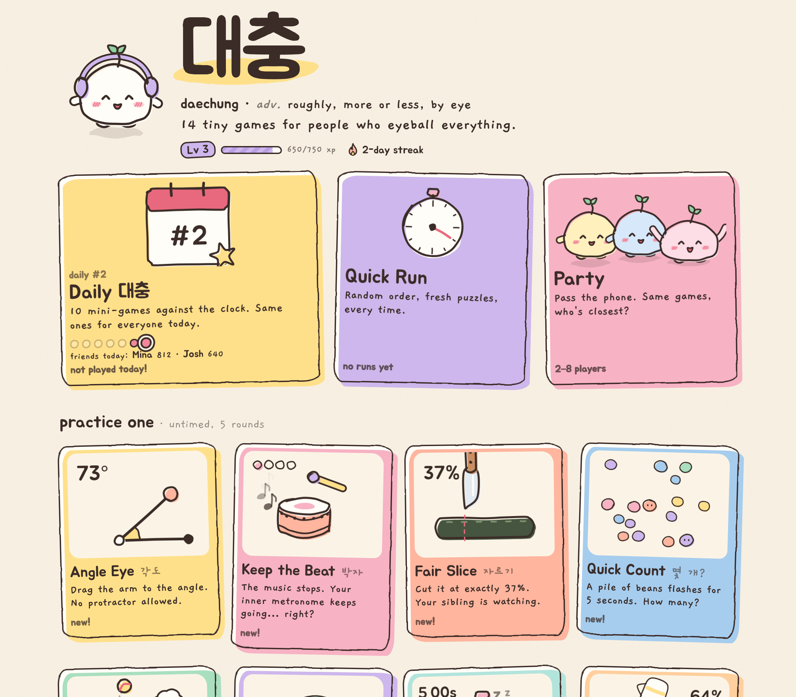
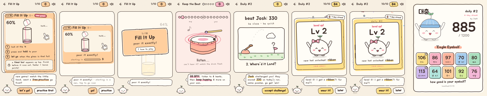

# 대충 · daechung

*adv.* roughly, more or less, by eye.

**Play: https://goshuajoh.github.io/daechung/**

Fourteen tiny hand-drawn mini-games that test how good your eyeball is, hosted by **Kongi (콩이)**, a little bean-sprout mochi.




## Ways to play

- **Daily 대충**: 10 of the 14 mini-games back to back, each on a countdown. The mix and the puzzles come from the daily number, so everyone gets the same run, which is what makes challenge links work. A friend's link from a day ahead or behind (timezones) still plays their puzzles.
- **Quick Run**: same format, a random 10 every time.
- **Party**: pass the phone. 2–8 players get the identical run (5 or 10 games), then there's a podium and a "closest eyeball per game" list.
- **Practice**: any single game, 5 rounds that get harder, no clock.

In runs, each game scores up to **100 for accuracy + 20 speed bonus** (how much of the countdown was left).



### Learning a game (Bishi Bashi style)

Before every game there's an instruction card. How much it says depends on how many times you've played that game (per device, or per player name in Party):

- **new**: looping demo with a cartoon hand plus three numbered steps. A free **practice** try is offered but never forced. It's untimed, doesn't count, and has training wheels: the live angle / % / time, a dashed circle to trace, the target colour pinned in the corner, beat guide rings.
- **learning** (1–2 plays): the demo and one line, then it auto-starts after a 3-second bar (tap to go now).
- **pro** (3+): a quick flash card with a "? how to play" button.

On top of that, a hand points at what to touch if you stall, every target has a plain-words caption ("make this angle", "fill the glass this full"), and the timer bar has a clock and a seconds count. The very first timed card also explains it.

### Why you come back tomorrow

- **XP & levels**: every point you score is XP. Levelling up unlocks hats for Kongi: ribbon, beanie, party hat, headphones, chef hat, flower crown, cap, crown, halo. Tap your level on the home screen to open the closet.
- **Daily streak**: a flame counter plus a 7-day strip on the Daily tile.
- **Challenge a friend**: after the Daily, "challenge friends" shares a picture of your result plus a link with your scores packed in. Your friend gets the same puzzles, sees your score after each game, and ends on a head-to-head with W/L per game. No server involved.
- **Friends' scores**: every challenge link you open is remembered, so the Daily tile shows "friends today: Mina 812 · Josh 640", and after your run Kongi tells you who you beat. The Daily tile and finale also count down to the next daily.
- **Your profile** (tap your level on the home screen): your "eyeball type" (Shape Whisperer, Ratio Ruler, Human Metronome, Physics Brain, Bean Counter or Steady Artist), a six-skill radar, a calendar of your dailies, per-game averages, your name and the hat closet.
- **Party**: the pass-the-phone screen shows the score to beat.
- **Juice**: scores count up, 95+ gets a PERFECT banner with a burst and a screen shake, and 70+ rounds in a row build a combo.

### Sound

Keep the Beat flashes the whole stage and pulses rings on every beat, so it works with the sound off or in a noisy room. Android phones also vibrate.

## The games

| game | what you do |
|------|-------------|
| **Angle Eye** 각도 | Drag an arm to make the angle you're given. |
| **Keep the Beat** 박자 | Listen to a beat, keep tapping after it stops. Some rounds go silent and you tap one far-off beat. |
| **Fair Slice** 자르기 | Chop a kimbap / baguette / sausage / swiss roll / cucumber at exactly N%. |
| **Quick Count** 몇 개? | A pile of beans flashes for a few seconds. Guess how many. |
| **Where'd it Land?** 궤도 | A ball goes invisible mid-flight. Tap where it lands. |
| **Perfect Circle** 동그라미 | Draw a circle around the dot in one stroke. |
| **Inner Clock** 몇 초? | Stop the watch at exactly N seconds. It falls asleep after one. |
| **Fill It Up** 붓기 | Hold to pour; let go at exactly N% full. One pour. |
| **Dead Center** 중심 | Tap the exact center of a shape. Later ones only show an arc. |
| **Color Recall** 색깔 | Memorize a colour, then find it again on a hue wheel. |
| **Brake!** 주차 | Tap once to brake a rolling car so it slides to a stop right on the line. |
| **Halfway** 반 | Tap the exact middle of a squiggly road. Later roads hide extra wiggles in one half. |
| **Bigger?** 더 큰 거 | Six quick-fire pairs of different shapes: tap the one with more area. |
| **Tunnel** 터널 | A ball rolls into a tunnel at a steady speed. Tap when it's under the flag. |

Best scores are saved in your browser.

## Run it

```bash
npm install
npm run dev
```

`npm run build` outputs a static site to `dist/`.

## Deploy

Pushing to `main` runs `.github/workflows/deploy.yml`, which publishes to GitHub Pages.
Turn it on once in the repo: **Settings → Pages → Source: GitHub Actions**.

## How the look works

No image assets and no emoji: everything is drawn in code.

- `src/lib/pen.ts` is a small "wobbly pen" for canvas. Every shape is jittered with a seeded RNG that re-rolls about 7 times a second, so lines "boil" like a looping hand-drawn animation. Fills are offset from their outlines, like a slightly misregistered riso print.
- `src/lib/kongi.ts` draws the mascot with that pen. Moods: idle, happy, cheer, wow, sad, focus, listen.
- DOM bits (buttons, cards, speech bubble) get the same boil from an SVG `feTurbulence` filter that's re-seeded from JS.
- Sounds are synthesized with Web Audio in `src/lib/audio.ts`. There are no audio files.
- Fonts: [Jua](https://fonts.google.com/specimen/Jua) and [Gaegu](https://fonts.google.com/specimen/Gaegu).

## Install & offline

It's a PWA: add it to your home screen (Chrome shows an install button; on iPhone use Share → Add to Home Screen) and it runs full-screen with its own Kongi icon. A service worker precaches the build, so after the first visit everything, fonts included, works offline. On iPhone the home-screen app keeps its own storage, separate from Safari, so the tip suggests installing *before* your first Daily.

## Keeping phones cool

Every canvas shares one animation loop and has its own frame-rate cap: home art at about 12fps (the doodles "boil" at 7fps anyway, so it reads as stop-motion), the game stage at 30fps going up to 60fps only while you're dragging or something is flying, and nothing ever runs at the display's 120Hz. Canvases pause when scrolled off-screen, the backing store is capped at 2× pixel density, and the Web Audio context suspends itself after a couple of seconds of silence or when the app is backgrounded. DOM doodle borders use a static SVG filter, because filters are CPU-rendered on iOS.

## Adding a game

Make a `GameDef` (see `src/lib/shell.ts`) with a `thumb()` for the home card, `steps` + a `demo()` for the how-to card (`src/lib/hand.ts` has the pointing hand), and an async `play(shell, level)` that returns `{ score, detail }` for one challenge. Use `shell.lockIn(confirm, seconds)` (or `shell.clock(seconds)`) so it works on the countdown in runs, and draw randomness from `src/lib/rng.ts` so daily and party runs stay identical across players. Check `shell.tutorial` to switch on training wheels. Register it in `src/main.ts`; the modes in `src/modes.ts` / `src/party.ts` pick it up automatically.
